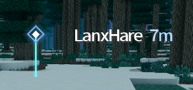
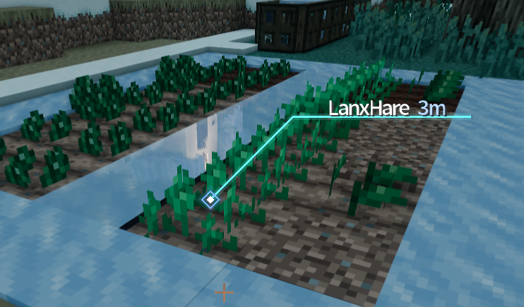
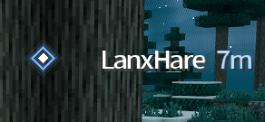

# Pin 标记模组


[](https://github.com/LanxHare-GIT/pin-1.7.10/actions/workflows/build.yml)

[English](README.md) | [简体中文](README.zh_CN.md)

本仓库是 Pin 标记模组的 **Minecraft 1.7.10**（Forge 10.13.4.1614）版本。

## 简介

按下标记键（默认 `R`）为你正在看的方块打上标记。同维度内所有玩家都能看到这个标记，
以及标记者的名字和距离。标记会自动消失；对着同一个方块再按一次键即可移除自己的标记。

## 预览

| 竖直标记 | 引线标注 |
| --- | --- |
|  |  |



## 功能

- 两套显示预设：竖直标记（菱形 + 竖线）与引线标注（菱形 → 45° 斜线 → 水平线 → 文字）。
- 菱形、线条、引线全部使用矢量绘制，标记与文字始终严格对齐。
- 线条选项：实心或柔边、屏幕像素长度或世界空间高度。
- 文字选项：与线条/菱形的间距，以及水平、垂直方向的微调偏移。
- 画外指示：箭头或菱形两种形状，颜色与标记同步。
- 游戏内配置界面，带实时预览。
- **已适配并测试于 GT New Horizons 2.9.0-RC2。** 模组本身没有额外依赖，原版 Forge 1.7.10
  环境同样可用；GTNH 是用于兼容性测试的整合包。

## 安装

将 jar 放入 `minecraft/mods/` 目录。模组需要在客户端和服务端**双方**安装，没有额外前置依赖。

## 配置

配置文件 `config/pin.cfg` 会在首次启动时生成，也可以在游戏内的 Mod Options 界面中修改。

| 分组 | 选项 | 说明 |
| --- | --- | --- |
| `display` | `preset` | `0` 竖直标记，`1` 引线标注 |
| `display` | `outsideShape` | `0` 箭头，`1` 菱形（画外标记形状） |
| `marker` | `showDot` | 是否绘制菱形 |
| `marker` | `dotColor` / `dotSize` / `farGrowth` | 菱形颜色、大小、随距离放大 |
| `line` | `lineEnabled` / `lineSolid` | 是否显示线条；实心无光晕 |
| `line` | `lineWorldSpace` / `lineHeight` | 线条相对地面垂直；高度（格） |
| `line` | `lineLength` / `lineWidth` / `lineColor` | 屏幕像素长度、粗细、颜色 |
| `label` | `labelGap` | 与横线（引线模式）或菱形（竖直模式）的间距 |
| `label` | `labelOffsetX` / `labelOffsetY` | 文字的精细偏移 |
| `gameplay` | `lifetimeSeconds` | 自动消失时间（秒） |

## 下载

构建产物以 `v*` 标签的 Release 形式发布。每次推送也会在 GitHub Actions 中生成可下载的
构建产物。

## 构建

需要 JDK 8。

```bash
cd 1.7.10
./gradlew setupCIWorkspace
./gradlew build
```

构建产物位于 `1.7.10/build/libs/`。

## 问题反馈

遇到问题或有建议，请到
[github.com/LanxHare-GIT/pin-1.7.10/issues](https://github.com/LanxHare-GIT/pin-1.7.10/issues)
提交。请附上 Forge 版本、模组版本以及完整日志。

## 贡献

欢迎提交 Pull Request。请保持改动聚焦，并遵循所修改文件的代码风格。

## 本地化

已包含 `en_US` 与 `zh_CN`。语言文件必须使用 UTF-8 编码。新增语言只需在
`1.7.10/src/main/resources/assets/pinmod/lang/` 下按对应语言代码创建文件。

## 致谢

* (c) 2020 TeamFruit，Pin 模组原作者
* Notch 及所有 Minecraft 贡献者
* Lex 及所有 MinecraftForge 贡献者
* Kamesuta、sjcl
* 开发协助：[DeepSeek-V4.1-Flash](https://www.deepseek.com/)
* 所有[贡献者](https://github.com/LanxHare-GIT/pin-1.7.10/graphs/contributors)
